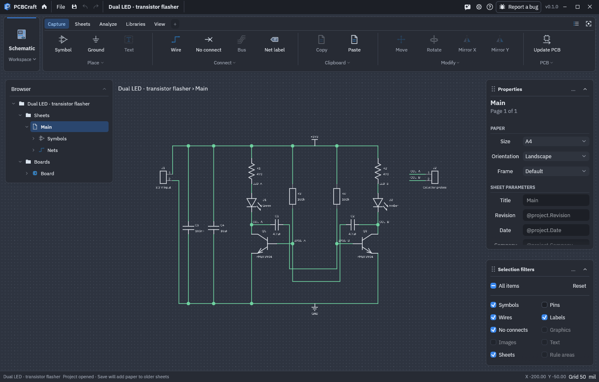

# PCBcraft

PCBcraft is an open-source electronics design application for drawing schematics
and laying out printed circuit boards. The desktop and browser editors share
the same project model, so a schematic and its board can be edited together.
On desktop, an assistant can work in the open editor through the same commands
and undo history you use.

Start with the [quickstart](../quickstart.md) to open and edit a project, or
download the [LED flasher example](../../examples/dual-led.pc) to explore a
routed board. The [PCB layout workflow](../pcb-layout-workflow.md) follows a
design from footprint assignment through routing, checks and supported
fabrication outputs.

PCBcraft is in early development. The [capability inventory](../capabilities.md)
describes which tools and formats the current code supports. For scripting or
working alongside an agent, see the [AI assistants and MCP guide](../mcp.md).
For working on the application, start with [Contributing](../../CONTRIBUTING.md).
