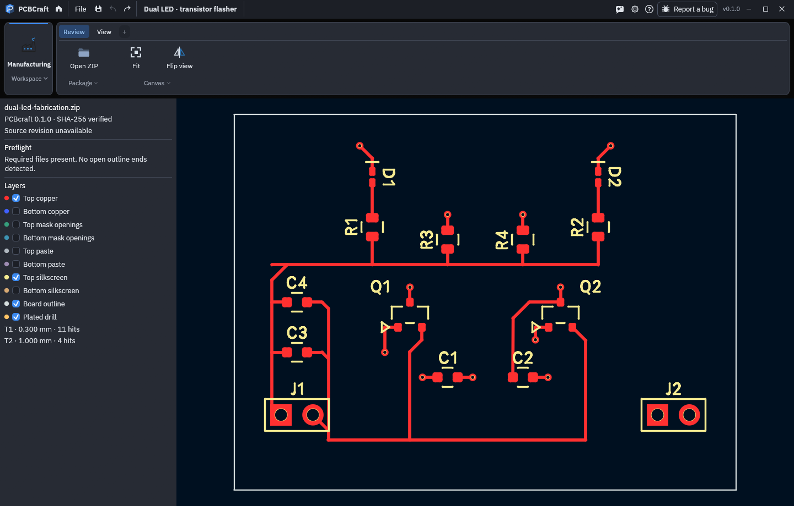

# Fabrication through MCP

## Generate fabrication files

`pcb.export_fabrication` generates the addressed board's fabrication files without
editing it; `execute` returns `fabrication.files`, each with a `name` and text `contents`,
and `fabrication.origin`, the placement origin used for coordinates in the generated
files: Gerber X2 copper per layer, mask, paste and silkscreen for both sides, and the
outline, plus one Excellon plated drill file. Boards with placed circular non-plated
holes also get a separate non-plated drill file. Export requires a board setup, a
resolvable placement origin, and at least one closed Board Outline loop. The Gerber
profile includes the closed loops and omits open outline paths. Boards with copper
zones or non-plated holes whose diameters round to zero in the drill file are refused
before any output is returned.
File names are deterministic and unique after portable-name sanitization,
including case-insensitive collisions with fixed-purpose output names. `apply`
validates board and file generation, not ZIP construction; `execute` also returns
`fabrication.manifest` for the same captured files and `fabrication.drill_chart`.
Its `rows` list every tool of each returned drill file, plated file first, in
declaration order: `plating` (`plated` or `non_plated`), the file's `tool` number,
`diameter_nm`, `size_mm` as the tool declaration writes it and the hole `count`.
The rows are built from the same holes as the drill files, so their counts always
match the files' hits. Neither operation writes files
or changes the project or revision; `execute` does not build or return a ZIP.

The manifest matches the `manifest.json` embedded in the fabrication ZIP for the
same capture: `generator_version` and ordered `files` records with `name`,
`size_bytes` and lowercase hexadecimal `sha256` of the uncompressed UTF-8 bytes.
It lists only the generated files, not itself. Clients that used
`fabrication.manifest.archive` must adapt: the outer ZIP name, size and digest are
no longer reported. Member records are independent of the ZIP filename. They
support byte checks, not source identity, configuration or check freshness. See
[desktop/browser publication limits](../editor-guide.md).

## Review a fabrication ZIP

To review a PCBcraft fabrication ZIP, use `app.set_workspace` with
`workspace: "manufacturing"` and the desired pane placement, then call
`app.open_fabrication_package` with that view ID and an absolute ZIP path.
The `last_fabrication_export` field in `inspect_editor` reports the last
successful desktop export path for the current project opening.
Inspect `views[].manufacturing` for the pending read, verified layer and drill-tool
details, preflight findings, or an error. A failed read preserves the previous
package. Use `app.set_fabrication_layer` with the exact member filename to set
visibility in that pane, and `view.fit` to frame the package.
