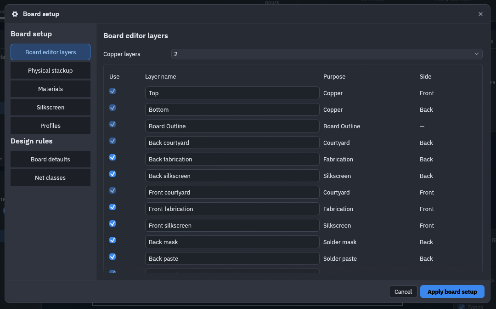
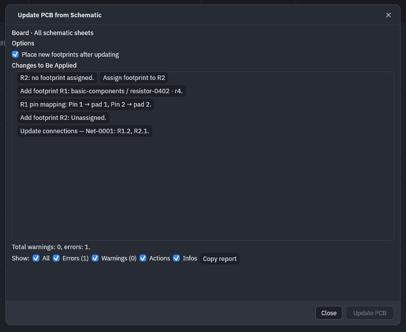
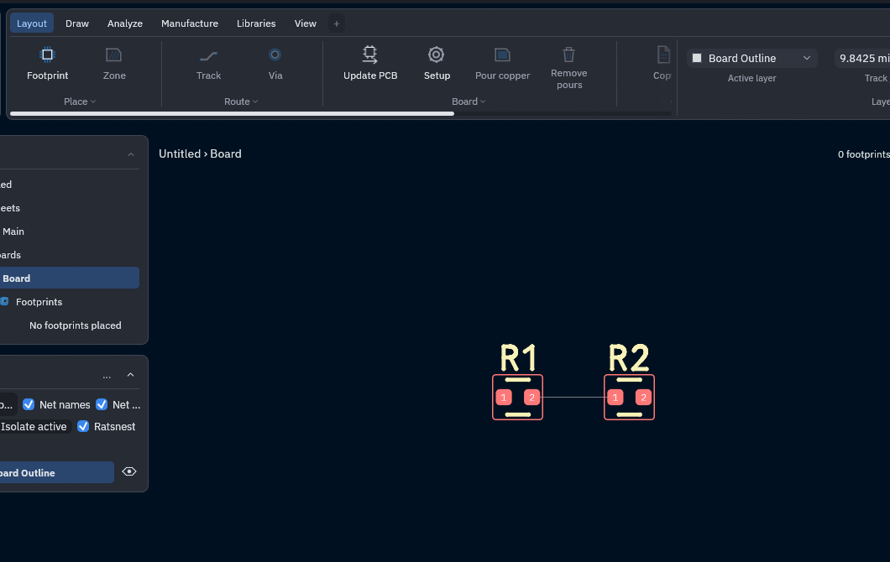
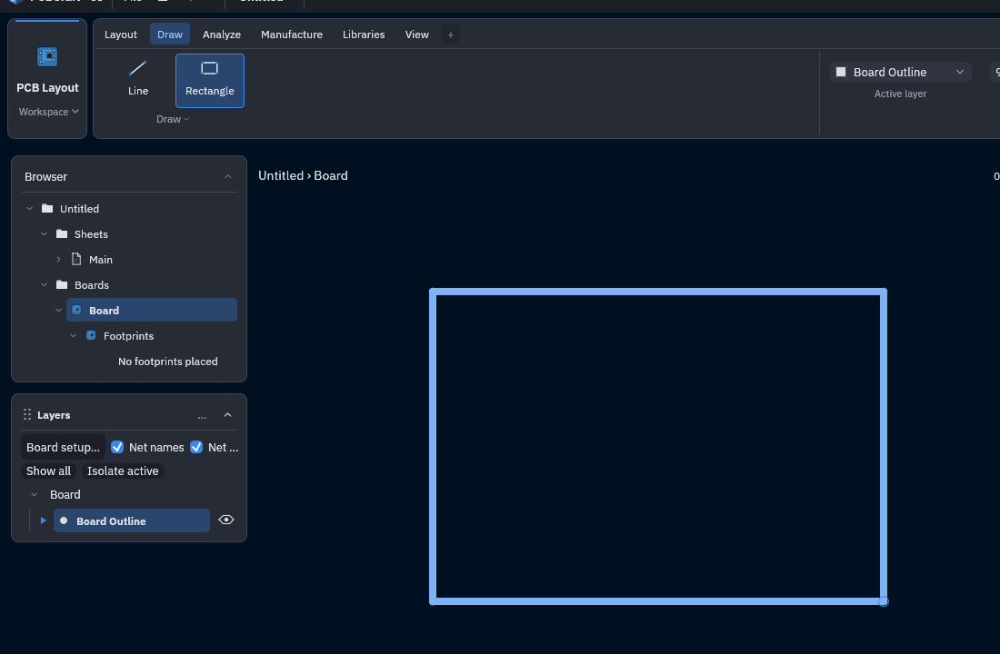
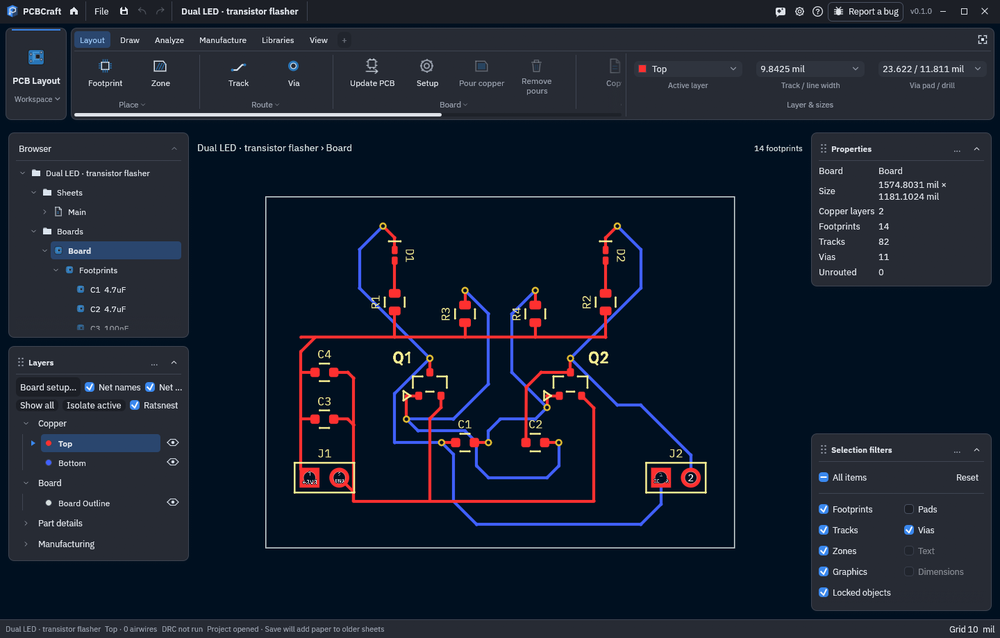
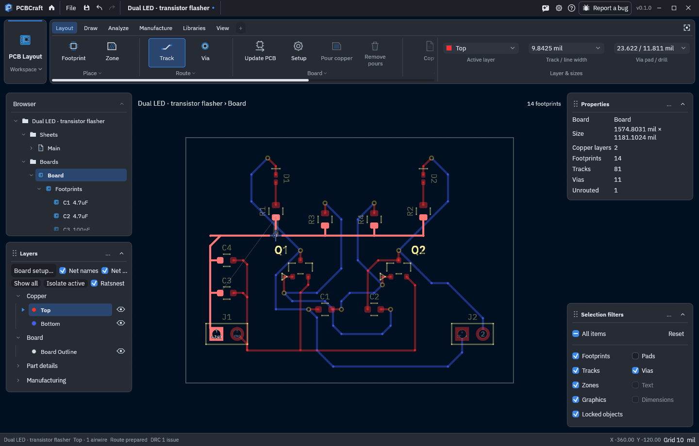
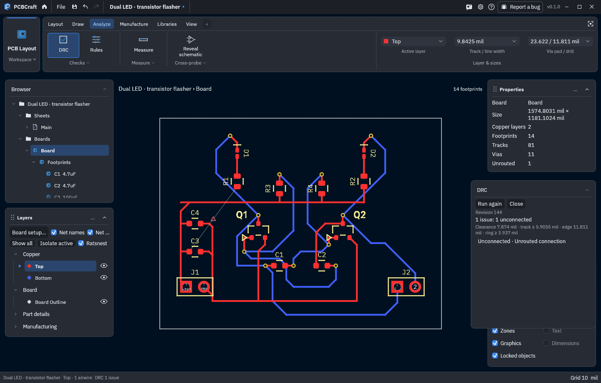
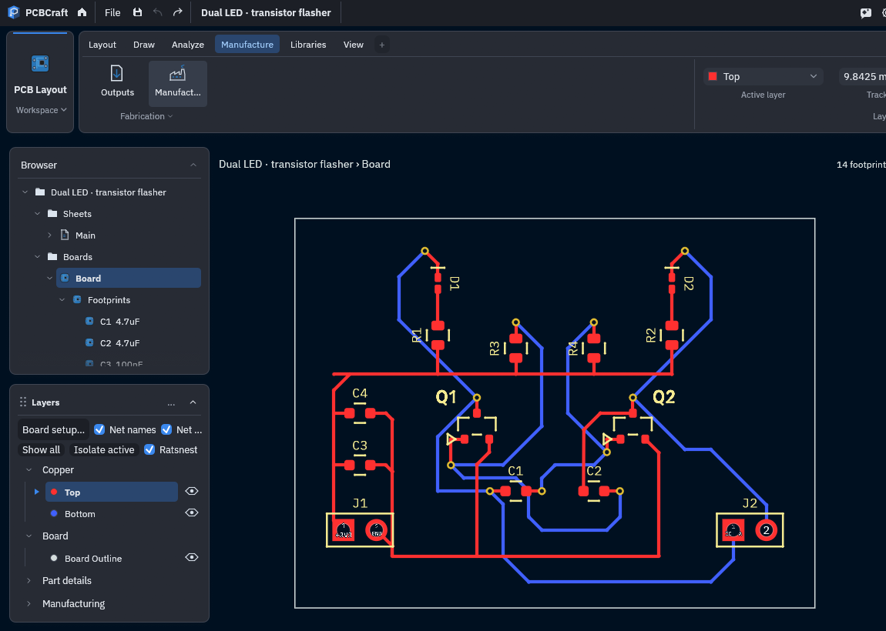
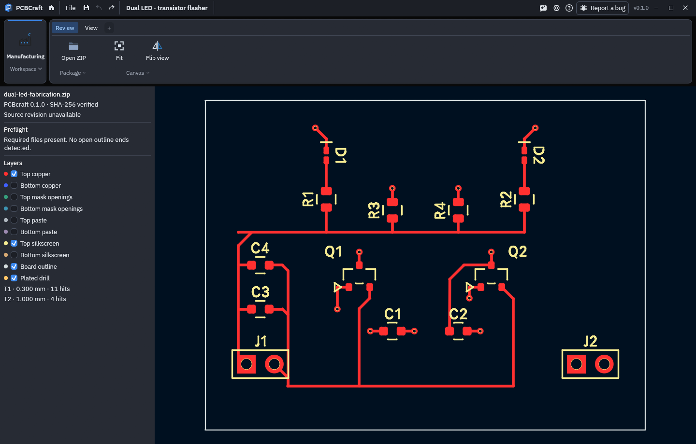
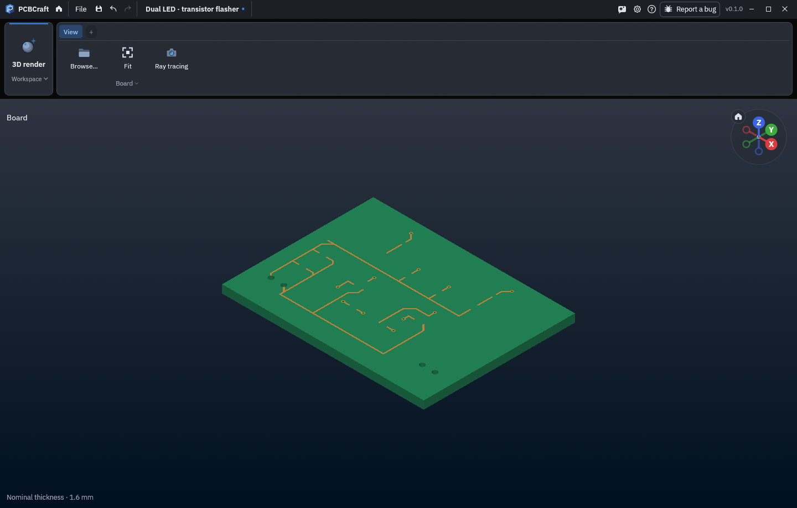

# PCB layout editing workflow

Workflow and plan first recorded November 9, 2026; board-rule and net-class
status updated November 14, 2026. Related work:
[#54](https://github.com/tangency-labs/pcbcraft/issues/54) (board workspace), [#56](https://github.com/tangency-labs/pcbcraft/issues/56) (tracks, vias and interactive routing),
[#57](https://github.com/tangency-labs/pcbcraft/issues/57) (copper zones), [#58](https://github.com/tangency-labs/pcbcraft/issues/58) (DRC), [#59](https://github.com/tangency-labs/pcbcraft/issues/59) (fabrication outputs),
[#77](https://github.com/tangency-labs/pcbcraft/issues/77) (net classes and rules) and [#95](https://github.com/tangency-labs/pcbcraft/issues/95) (two-layer track and via editing).

This guide follows a board from placed footprints to fabrication files.
See the [PCB layout design plan](design/pcb-layout-gaps.md) for staged work
and the [capability inventory](capabilities.md) for current limits.

## The workflow today

When a project has no board, PCB Layout shows **Create board** and **Open
schematic**, along with the sequence for board setup, adding schematic footprints
through Update PCB, and drawing the outline and routing. Opening the workspace
or returning to the schematic does not create a board. **Create board** opens
Board setup as a draft. Cancel returns to the empty state without changing the
project; **Apply board setup** creates the board and saves its settings together
as one undoable edit. Board defaults and net classes become available after creation.

The PCB ribbon separates Layout, Draw, Analyze, Manufacture, Libraries and
View. Layout groups placement, Route, clipboard, selection edits and board
setup/synchronization; alignment is available in Modify's menu. Draw operates
on the active layer, while layer, width and via settings stay visible across
tabs. Analyze holds checks and inspection; Manufacture holds outputs.
Planned tools remain disabled in their task's menu. Every edit below uses a
revision-checked engine command that the GUI, live MCP and headless MCP share.
Each edit is one undo step.

| Step | What works | Where |
| --- | --- | --- |
| Set up | Copper count, stackup and materials, silkscreen settings | Layout › Board › Board setup |
| Place | Assign packages, place, move (M or drag), rotate (R), flip to the bottom side (F), exact X/Y/rotation/side in Properties, align and distribute | Layout › Place / Modify, Properties |
| Draw | Active-layer lines and rectangle outlines: conductive copper segments or non-copper graphics with physical strokes; Board Outline vertex, segment and whole-shape edits | Draw |
| Route | Tracks with an explicit width and clearance-aware 45° walkaround. Stable snapping to pads, track ends and vias. Through vias with V or PgUp/PgDn mid-route, plus standalone vias | Layout › Route |
| Modify | Click, box and U (connected) selection. Selection filters for tracks and vias. M and selection moves, held track drags and D with the [active router policy](pcb/route-planning.md#track-shove), width and via size in Properties, per-track/via locks, Delete | Layout › Modify, Properties |
| Inspect | Net highlight (`), ruler (Ctrl+Shift+M), DRC with a results card and canvas markers, board summary when nothing is selected | Analyze, Properties |
| Output | Gerber X2 copper with net and pin attributes, mask, paste, silkscreen and outline layers, plus separate [Excellon drill files](manufacturing/drill-files.md#fabrication-drill-files) in one archive | Manufacture › Fabrication › Outputs |
| View | Mirrored bottom view, layer visibility and colors | View › Navigate › Flip view, Layers |

When items overlap, hover over them and press **Shift+Space** to cycle through
the selectable items at that point. A click on overlapping tracks starts with
the active copper layer. Layer visibility and selection filters also apply when
cycling. Tracks and vias in the gaps between footprint pads can be clicked
directly.

For closed Board Outline graphics, select an edge, then drag the edge to move
that side parallel to itself. Drag inside the selected outline to move the whole
shape or drag a corner to reshape it. Right-click a selected edge or corner to
add or remove a vertex. The [zone editing guide](pcb/copper-zone-outlines.md#drawing-and-editing)
describes the shared axis alignment and vertex controls.

Copper connectivity is derived from overlap on shared layers. Track edits and
footprint transforms refuse new shorts in the copper they touch. DRC separately
reports existing islands that contain conflicting intended nets, including direct
pad contact and via-mediated connections. It uses accepted board connectivity when
available and otherwise the project-wide logical graph; names are display text,
not the identity used to compare memberships. DRC checks the board without editing
it. A `pcb.check_design` request can override the fixed defaults for that run. Short
findings include sorted copper references and the involved component-terminal keys,
grouped by snapshot-local net index. Those indices must not be used as saved bindings.

### Set up the board

In **Layout → Setup**, select the copper count and the board layers you need.
Use **Physical stackup** to review the construction. When the settings are
ready, choose **Apply board setup**.

### Bring the schematic onto the board

Use **Update PCB** to review the parts and connections that will transfer. In
this two-resistor example, Update PCB is waiting for a footprint for R2. Choose
**Assign footprint to R2** to resolve the error, then review the mappings and
connections before applying the update. If **Place new footprints after updating**
is checked, the new footprints follow the pointer until you click to place them.

### Draw the outline and route copper

Set **Board Outline** as the active layer, then choose **Draw → Rectangle** and
click opposite corners to create a closed outline. On the routed LED flasher
example, the outline is the white rectangle around the footprints and copper.

Select a copper layer and choose **Layout → Track** (or press **X**). Start on a
pad, then move toward another pad or copper on the same net. The router
highlights that net and previews the new copper before you commit. To
practice on a copy of the flasher, remove a short track segment first to
make an airwire visible. **V** inserts a through via during routing.

### Check the board

Choose **Analyze → DRC**. The DRC card lists findings and the canvas shows where
they occur. Select a finding to center it, then run the check again after
editing. The removed track from the routing exercise produces the unrouted
connection in this example.

### Export and review fabrication files

After checking the board, choose **Manufacture → Outputs** to save the Gerber
and drill ZIP. Open the **Manufacturing** workspace and choose **Open ZIP** to
inspect the package you saved. Toggle layers separately to review copper,
silkscreen, the board outline and drill hits.

## Preview the board in 3D

On desktop, choose **3D render** from the workspace picker. Open it beside
PCB Layout to watch outline and hole changes as you edit or undo. **Browse…**
chooses another board in the open project without switching the layout pane.

Drag to orbit, middle-drag to pan, and scroll to zoom. Use the compass to look
along a board axis or return to the isometric view. **Fit** frames the board in
the current orientation.

**Ray tracing** toggles live GPU path tracing. Orbit, pan, zoom and Fit work
in both modes. The raster preview follows the camera during navigation.
When the camera has been still for 650 ms, the viewer starts a new ray-traced
frame. The canvas shows progress while the renderer prepares shaders, builds
the board scene, or traces the frame. Ray tracing needs a compatible hardware
Vulkan or Metal adapter.

The preview shows the substrate from a closed Board Outline, including cutouts
and supported round through holes. It uses the declared finished stackup
thickness or displays a nominal 1.6 mm when no thickness is specified.
Exterior tracks and through-via rings are visible on the corresponding
board faces. Pads, silkscreen, component models and STEP export are later parts of
[#86](https://github.com/tangency-labs/pcbcraft/issues/86).

The preview and STEP substrate use the same board/1 frame, with Z = 0 at
the finished top surface. The [3D model record and frame contract](design/3d-model-records.md)
from [PR #504](https://github.com/tangency-labs/pcbcraft/pull/504) defines how future
STEP model bindings attach to this frame. Package models seat on the board
surface on their placement side, with a half-turn about Y on the bottom.
The model record and package-binding codecs are still pending.

To refresh a linked SolidCraft assembly after
saving an outline edit, see the [parametric outline exchange prototype](RFC/parametric-outline-prototype.md)
from [PR #594](https://github.com/tangency-labs/pcbcraft/pull/594). The prototype
publishes the exact substrate from the saved archive. Both viewport modes
use the open board geometry, including edits before Save.

## PCB operations

- [Unroute one connection](pcb/unroute.md)
- [Set-pitch distribution](pcb/set-pitch-distribution.md)
- [Align to a reference footprint](pcb/align-to-reference-footprint.md)
- [Placed-footprint locks](pcb/locks.md#placed-footprint-locks) and
  [fixed tracks and vias](pcb/locks.md#fixed-tracks-and-vias)
- [Fabrication drill files](manufacturing/drill-files.md)

## Format changes at a glance

| Slice | Stored formats | Stored |
| --- | --- | --- |
| 1. Footprint moves carry copper | none | — |
| 2. Board rules (implemented) | board/59 | Board-scoped rule records |
| 2. Net classes (implemented) | project/20 for definitions; project/21 with bindings; instances/3 for board-owned bindings | Project class definitions and assignments to persistent net IDs; consumers add no saved vocabulary |
| 3. Clearance while routing | none | — |
| 4. Zones | board/59 | Zone outlines and connection-removal settings; fills are not stored |
| 5. Push-and-shove | none | — |
| Placed-footprint lock metadata | [board/59](formats/native-project-storage.md#placed-footprint-lock-metadata) | Optional placement lock flags |
| Named layer groups | [board/59](formats/native-project-storage.md#named-layer-groups) | Authored named groups |

Current saves use board/59 even when no zone uses connection-based island
removal. Board/43 and earlier supported boards load with the option off and
adopt board/59 on Save. Subsequent no-op saves preserve current bytes. See the
[native board format](formats/native-project-storage.md#current-board-records).

Standalone vias can retain an explicit net through placement and Properties; see
[via net assignments](pcb/via-net-assignments.md) for automatic inheritance, physical
connectivity and unresolved-target behavior.
